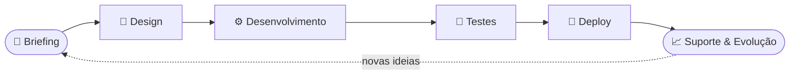

[)](https://pimentelcode.com.br)

---

### ⚡ Transformo processos manuais em sistemas que rodam sozinhos.

Desenvolvo **sites, plataformas web e automações inteligentes** para negócios que querem escalar **sem aumentar a equipe**.

---

## 🧠 Sobre mim

---

## 🛠️ O que eu construo

| | Serviço | Entrega |
|:---:|:---|:---|
| 🚀 | **Landing Pages de Alta Conversão** | Design moderno, mobile-first, otimizada para tráfego pago e SEO |
| 🌐 | **Sites & Sistemas Web** | Institucionais, catálogos, painéis administrativos e dashboards |
| 🤖 | **Automações & Agentes de IA** | Fluxos com n8n, integrações via API e agentes que executam tarefas reais |
| 🧩 | **Arquitetura SaaS** | Modelagem de banco, autenticação, multi-tenant e escalabilidade |
| 🔗 | **Integrações & APIs** | CRM, WhatsApp, Instagram Graph API, pagamentos e webhooks |

---

## 💻 Stack Tecnológica

**Front-end**

**Back-end & Dados**

**Infra & Ferramentas**

**Automação & IA**

---

## 🚀 Projetos em Destaque

<table>
<tr>
<td width="50%" valign="top">

### 🎙️ DictaFlow
App desktop de **ditado por voz com IA**: transcreve, corrige e digita sozinho na janela ativa.

[**▶ Ver ao vivo**](https://dictaflow-v2.vercel.app)

</td>
<td width="50%" valign="top">

### 🤖 Automação WhatsApp
Disparo **personalizado** para leads de imobiliária a partir de planilha Excel, com sessão em cache e retry inteligente.

[**⌨ Código**](https://github.com/PimentelCode/Automacao-WhatsApp)

</td>
</tr>
<tr>
<td width="50%" valign="top">

### 💰 Controle Financeiro
App desktop de finanças pessoais: **parcelamento semanal**, múltiplos perfis, dashboard e backup automático.

[**▶ Ver ao vivo**](https://controle-financeiro-plum-six.vercel.app) · [**⌨ Código**](https://github.com/PimentelCode/controle-financeiro)

</td>
<td width="50%" valign="top">

### 📡 NFC Automa
Site de produto para **tags NFC** prontas e testadas.

[**▶ Ver ao vivo**](https://nfc-automa.vercel.app)

</td>
</tr>
<tr>
<td width="50%" valign="top">

### 🚗 VCar Veículos
Site institucional para **revenda de veículos**.

[**▶ Ver ao vivo**](https://vcarveiculos.vercel.app)

</td>
<td width="50%" valign="top">

### ⚖️ Central de Direitos do Consumidor
Ferramenta web de **apoio rápido** ao cidadão brasileiro em situações de dificuldade.

[**▶ Ver ao vivo**](https://central-de-direitos-do-consumidor.vercel.app) · [**⌨ Código**](https://github.com/PimentelCode/Central-de-Direitos-do-Consumidor)

</td>
</tr>
</table>

---

## 🔄 Como eu trabalho

---

## 📊 Atividade

<picture>
  <source media="(prefers-color-scheme: dark)" srcset="https://raw.githubusercontent.com/PimentelCode/PimentelCode/output/github-snake-dark.svg" />
  <source media="(prefers-color-scheme: light)" srcset="https://raw.githubusercontent.com/PimentelCode/PimentelCode/output/github-snake.svg" />
  
</picture>

---

## 🎓 Formação

**Análise e Desenvolvimento de Sistemas** — Descomplica UniAmérica | 2025 – 2026 
📍 Foz do Iguaçu, PR — Brasil · GMT-3

---

## 📬 Vamos conversar sobre o seu projeto?

Respondo rápido no WhatsApp e no Instagram.

